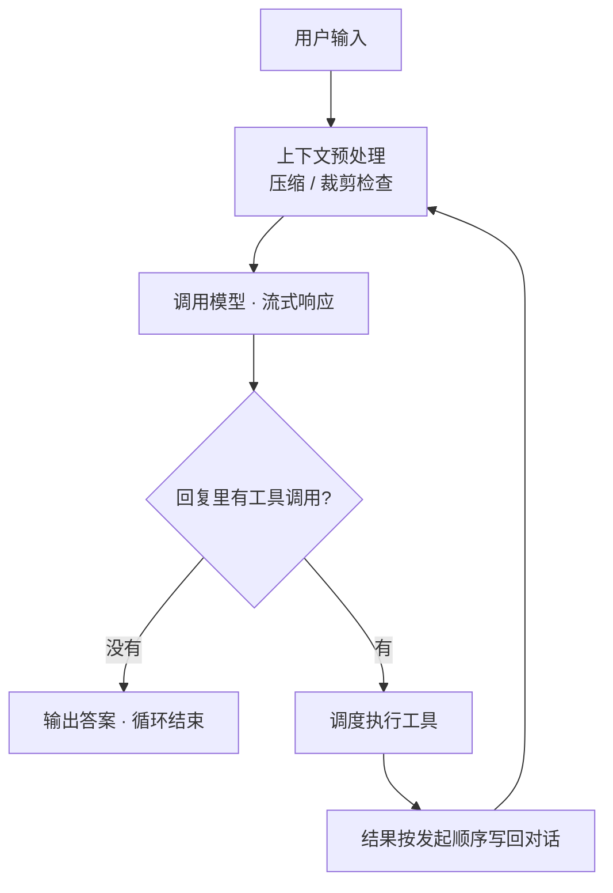

> 说明：Claude Code 没有官方开源，本文内容基于社区逆向还原的源码研究（主要参考 [claude-code-from-source](https://claude-code-from-source.com/) 的分析和 [doge-code](https://github.com/HELPMEEADICE/doge-code) 等可运行的还原代码树），细节以当前线上版本为准，仅供学习。

## 先说结论

把所有花哨的功能剥掉，Claude Code 的内核只有一行逻辑：

```
while (true) {
    调模型，拿到回复
    如果没有工具调用 → 结束，输出答案
    执行工具，把结果塞回对话
    继续下一轮
}
```

没别的了。它能读文件、跑命令、改代码，靠的就是模型每轮输出"我要调哪个工具"，循环负责真的去调，然后把结果喂回去。所谓 Agent，就是这个循环加一组工具。

有意思的地方在于：这个看起来简单的循环，外面裹了一层又一层的工程手段——工具怎么并行、结果怎么排序、上下文快满时怎么自动压缩、报错后怎么恢复。每一层都对应一类真实撞到过的坑。这篇文章按"一轮对话的时间线"把这些机制串起来讲。

## 一轮对话里发生了什么

用户敲下一句话之后，到答案出现之前，代码里发生的事情按顺序是：



几个关键点展开说。

**1. 每轮开始前，先做上下文管理。** 发请求之前，循环会检查当前对话离模型的上下文上限还有多远，必要时先压缩（后面细讲）。这一步在每轮都跑，而不是等爆了才处理。

**2. 模型响应是流式的，工具调用是"边到边跑"的。** 这是最值得学的一条。模型输出一个工具调用的 JSON 需要时间，等它把整个回复流完再开始执行工具，纯属浪费。Claude Code 的做法是：解析流的过程中，一个完整的 `tool_use` 块一到手就立刻开跑，与此同时模型还在继续吐后面的内容。等流结束的时候，前面几个工具可能已经执行完了。整个响应流完 → 结果也差不多在手，用户几乎感觉不到额外等待。

**3. 结果回填的顺序，不是完成顺序，而是模型发起的顺序。** 三个 Read 并行跑，第二个先完成、第一个最后完成，写回对话时依然按 a、b、c 的顺序排。原因很直白：模型的对话历史必须和它自己发出的调用一一对应，顺序乱了，下一轮模型就会对错号。快是执行层面的事，对话一致性是协议层面的事，后者优先。

## 工具为什么敢并行

并行执行工具有个前提：不能互相踩。Claude Code 的判断粒度不是"这个工具类型能不能并行"，而是"这一次调用能不能并行"。

| 工具 | 可并行？ | 判断依据 |
| --- | --- | --- |
| Read / Grep / Glob | 永远可以 | 纯读，无副作用 |
| Bash | 看命令 | 整条命令全是只读操作才行 |
| Edit / Write | 永远不行 | 改文件，两个并行写必坏 |

Bash 是最典型的"看情况"：`ls -la && cat README.md` 会把复合命令拆开逐段检查，发现每段都是读操作，判定可并行；`ls && rm -rf build/` 里只要混进一个写操作，整条命令就按串行处理。宁可错杀，不可放过。

实际调度时，循环把一轮里模型发出的工具调用排成一列，从左往右扫：连续的"可并行"调用归成一堆同时跑，碰到一个"不可并行"的就把队伍切断。于是 `[Read, Read, Grep, Edit, Read]` 会变成三段：前三个并行 → Edit 单独跑 → 最后一个 Read 再并行。

**为什么 Edit 必须单独跑？** 因为它改变了世界。Edit 前后两个 Read 读到的文件内容可能不一样——这就是数据依赖。依赖意味着不能并行，这个规则是通用的：任何"后面的调用要看到前面调用的效果"的场景，都得串行。

并行这边的默认值也值得注意：一个新工具如果忘了声明自己能不能并行，默认按"不能"处理。安全性上的默认值永远往保守方向设，这是个可以抄走的习惯。

## 延迟藏在哪里

一个 Agent 的响应时间大致由四段组成，优化手段各不相同：

| 延迟段 | 典型耗时 | Claude Code 的对策 |
| --- | --- | --- |
| 模型生成（思考 + 吐 token） | 秒级，占大头 | 流式输出边到边执行，不让工具等流结束 |
| 工具执行 | 视命令而定 | 并行批调度，只读工具同时跑 |
| 结果回填与下一轮组装 | 毫秒级 | 结果写回后立即进入下一轮，无额外等待 |
| 上下文超限时的压缩 | 秒级 | 分层压缩，优先做轻的，避免每次都全量摘要 |

几条具体的节流设计：

**流式投机执行**（streaming speculative execution）。上面说过，工具调用一解析完就开跑，不等流结束。模型一轮吐 3 秒的流，第一个工具调用可能 500ms 就出来了——它已经在跑的时候，模型还在讲后面的话。假如一轮里模型发了五个只读工具、响应流要 3 秒，这五个很可能在流结束前就全跑完了，流一结束直接拿结果进下一轮。

**权限检查提前并发。** 对 Bash 命令的安全分类器在管线里是提前启动的，和别的准备工作并行，而不是串在最后。常见的"扫一眼就知道放行"的路径省掉几百毫秒。

**上下文压缩分四层，从轻到重。** 这是延迟优化里最容易被忽略的一层：

1. **裁剪单条过大的工具结果**——最轻，直接砍
2. **清掉已经"消费完"的工具输出**——旧的文件内容、命令输出，模型已经看过并且用掉了，没必要永远留在上下文里占地方
3. **局部摘要**——把一整段对话折叠成摘要，保住其他部分的细节
4. **全量压缩**—— fork 一个专门的对话把整个历史总结一遍，最重、也最慢，放最后

排序逻辑很清楚：能用轻的就不动重的。前三层都是"删和叠"，最后一层才是"重新总结"。如果轻操作做完已经低于阈值了，全量压缩就不必发生。全量压缩还带熔断：连续失败 3 次就停止自动尝试，防止"压缩失败 → 重试 → 还是失败"死循环烧钱——生产环境真的发生过一晚上烧掉几十万 token 的案例。

**报错恢复不重头再来。** 输出超限、上下文超限这类可恢复错误，处理方式是"悄悄补救再继续"：先不把这个错误抛给上层（上层界面收到错误消息可能直接断开），在循环内部修好——比如自动压缩一把、把输出上限从 8K 提到 64K 再试——修不好才真的报错。对用户来说，一次内部恢复和一次正常响应看起来没区别。

## 循环怎么停

循环不是永远转下去的，退出原因在代码里是一个明确的枚举，大致分三类：

- **正常完成**：模型这轮没有再发工具调用，说明它认为活干完了
- **用户打断**：Ctrl+C，或者流式、工具执行阶段被中断
- **兜底触顶**：轮数到上限、token 预算用完、连续压缩失败熔断、不可恢复的模型错误

每类都有对应的收尾动作，最典型的是"孤儿工具调用"清理：协议规定每个 `tool_use` 后面必须跟着一个 `tool_result`。如果循环在中途被打断，有些调用还没来得及执行，直接把这段历史发回给模型会报协议错误。所以收尾时会给每个没跑完的调用补一条"我被中断了"的结果，让历史保持完整。

这个细节很小，但很能说明问题：循环的每一条退出路径都要保证"交还给模型的对话永远合法"。这也是写 Agent 代码时最容易漏的地方——正常路径人人都会写，协议完整性是在异常路径上守出来的。

## 如果自己写一个

把这些机制按"什么时候才需要"排个序，就是一个务实的学习路线：

1. **最小闭环**：`while(true)` + 一个工具 + 结果回填，50 行代码。这已经是一个能干活的 Agent。
2. **并行调度**：给工具加"是否只读"标记，只读的并行跑，结果按发起顺序回填。这一步做完，体感速度会有明显提升。
3. **流式投机执行**：解析流时工具块一到就开跑。实现稍麻烦（要处理流失败时已执行工具的丢弃），但省的时间是真实的。
4. **上下文管理**：先做最简单的"超限就压缩"，再考虑分层。单层压缩完全够用很久。
5. **错误恢复 + 熔断**：每种自动重试都设上限。没有熔断的重试，在长会话里迟早会变成烧钱循环。

顺序本身就是结论：Agent 的核心循环不值钱，值钱的是围绕它的调度和防御。而每一个防御机制背后，都是作者在生产环境里真实付过学费的坑。

---

- 主要参考：[claude-code-from-source](https://claude-code-from-source.com/)（Ch5 The Agent Loop / Ch6 Tools / Ch7 Concurrent Tool Execution）
- 官方文档：[Explore the context window](https://code.claude.com/docs/en/context-window)
- 本篇笔记对应的可运行代码样本：[doge-code](https://github.com/HELPMEEADICE/doge-code)
